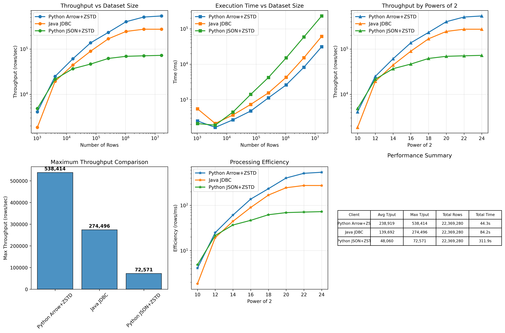
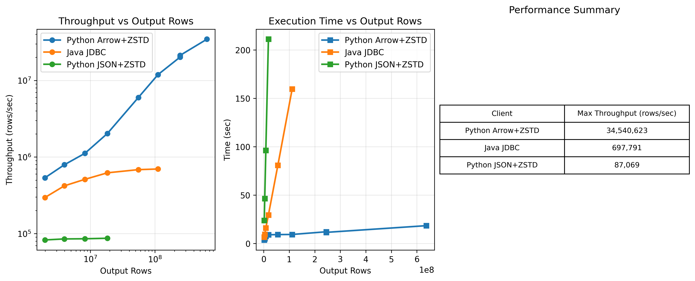

[](https://github.com/mvanderlee/aiotrino/actions?query=workflow%3Aci+event%3Apush+branch%3Apy3-async)
[](https://trino.io/slack.html)
[](https://www.starburst.io/info/oreilly-trino-guide/)

# Introduction

This package provides a asyncio client interface to query [Trino](https://trino.io/)
a distributed SQL engine. It supports Python 3.11, 3.12 and 3.13.

**Note**: This fork is designed to prototype Arrow spooling functionality in conjunction with the Trino server fork at [https://github.com/jonasbrami/trino](https://github.com/jonasbrami/trino), which implements server-side Arrow spooling support.

# Installation

This fork is not published on PyPI: `pip install aiotrino` installs the upstream
[mvanderlee/aiotrino](https://github.com/mvanderlee/aiotrino) package, which has no Arrow support.
Install the fork from GitHub, with the `arrow` extra (pyarrow >= 18) to use the Arrow interface:

```
$ pip install "aiotrino[arrow] @ git+https://github.com/jonasbrami/aiotrino.git"
```

# Quick Start

Use the DBAPI interface to query Trino:

```python
import aiotrino
conn = aiotrino.dbapi.connect(
    host='localhost',
    port=8080,
    user='the-user',
    catalog='the-catalog',
    schema='the-schema',
)
cur = await conn.cursor()
await cur.execute('SELECT * FROM system.runtime.nodes')
rows = await cur.fetchall()
await conn.close()
```
Or with context manager 
```python
import aiotrino
async with aiotrino.dbapi.connect(
    host='localhost',
    port=8080,
    user='the-user',
    catalog='the-catalog',
    schema='the-schema',
) as conn:
    cur = await conn.cursor()
    await cur.execute('SELECT * FROM system.runtime.nodes')
    rows = await cur.fetchall()
```

This will query the `system.runtime.nodes` system tables that shows the nodes
in the Trino cluster.

The DBAPI implementation in `aiotrino.dbapi` provides methods to retrieve fewer
rows for example `Cursor.fetchone()` or `Cursor.fetchmany()`. By default
`Cursor.fetchmany()` fetches one row. Please set
`aiotrino.dbapi.Cursor.arraysize` accordingly.

## Arrow Interface for High-Performance Data Fetching

The arrow interface provides efficient columnar data transfer for large datasets. This feature works in conjunction with the Arrow spooling prototype implemented in the [Trino fork](https://github.com/jonasbrami/trino/tree/arrow_spooling).

### Why Arrow?

A common use case of Trino is to retrieve a large chunk of structured data from a Data lake for later processing using local data processing libraries such as DataFrame libraries, data science libraries...
Large query output can be extremely slow to retrieve using Trino's pure python packages (aiotrino, trino-python-client) because of the huge deserialization cost.

We aim to solve this issue by introducing Arrow format to Trino's Spooling protocol multiplying the throughput of deserialization by hundreds!

This is achieved using fully asynchronous and parallel spooling segment retrieval and also leveraging the fact that PyArrow releases the GIL during the deserialization allowing true parallelism without the need for multiprocessing: Only coroutines (for the segment retrieval) and threads (for the arrow deserialization)

### Fetch the whole query output (Fast but require the client to have enough memory to hold the whole query output)

```python
import aiotrino
import asyncio

async def fetch_everything_in_memory():
    query = """
    SELECT * FROM your_catalog.your_schema.your_table 
    LIMIT 1000000
    """
    
    async with aiotrino.dbapi.connect(
        host="your-trino-host",
        port=8080,
        user='your-username',
        encoding="arrow+zstd"
    ) as conn:
        cursor = await conn.cursor(cursor_style="segment")
        async with cursor as cur:
            await cur.execute(query)
            # Fetch all the query output as Arrow table
            arrow_table = await cur.fetch_arrow_table()
            print(f"Fetched {len(arrow_table)} rows")
            return arrow_table

# Run the async function
arrow_table = asyncio.run(fetch_everything_in_memory())
```

### Fetch segment per segment (The client can stream the query output segment per segment)

```python
import aiotrino
import asyncio

async def stream_segment_per_segment():
    query = "SELECT COUNT(*) as total_rows FROM your_catalog.your_schema.your_table"
    
    async with aiotrino.dbapi.connect(
        host="your-trino-host",
        port=8080,
        user='your-username',
        encoding='arrow'
    ) as conn:
        cursor = await conn.cursor(cursor_style="segment")
        async with cursor as cur:
            await cur.execute(query)
            # Fetch single segment as an arrow table
            # Allows to stream query result to client
            while (arrow_table_segment := await cur.fetchone_arrow()) is not None:
                process(arrow_table_segment)

result = asyncio.run(stream_segment_per_segment())
```

### Stream record batches

`fetch_record_batches()` streams the result as `pyarrow.RecordBatch` objects, in order, with a bounded number of
segments downloaded and decoded ahead (`prefetch`):

```python
async with aiotrino.dbapi.connect(host="your-trino-host", port=8080, user="your-username",
                                  encoding="arrow+zstd") as conn:
    async with await conn.cursor(cursor_style="segment") as cur:
        await cur.execute(query)
        async for batch in cur.fetch_record_batches(prefetch=4):
            process(batch)
```

### ADBC-style API

The cursors mirror the [ADBC Python DB-API](https://arrow.apache.org/adbc/current/python/api/adbc_driver_manager.html)
(`adbc_driver_manager.dbapi`) with coroutines:

| Method | Description |
|---|---|
| `await cur.fetch_arrow_table()` (alias `fetchallarrow()`) | the rest of the result as a `pyarrow.Table` (`fetchall_arrow()` is a deprecated alias) |
| `async for batch in cur.fetch_record_batches(prefetch=N)` | the rest of the result as `pyarrow.RecordBatch` objects |
| `await cur.fetch_df(arrow_dtypes=False)` | a pandas DataFrame (TIME(9)/TIME(12) columns use `pandas.ArrowDtype`) |
| `await cur.fetch_polars()` | a polars DataFrame (INTERVAL YEAR TO MONTH as a number of months) |
| `cur.description` | PEP 249 description from the columns received by `execute()` (`await cur.get_description()` still works) |
| `cur.arrow_schema` | the Arrow schema of the result |
| `cur.rownumber` | number of rows fetched from the current result |
| `await cur.adbc_cancel()` | cancel the query |
| `await conn.adbc_get_info()` | vendor name/version (from `/v1/info`), driver name/version, pyarrow version |
| `conn.adbc_current_catalog`, `conn.adbc_current_db_schema` | catalog and schema of the session (follow `USE`, can be set) |

The segment cursor (`cursor("segment")`) receives the Arrow segments as is; the row cursor (`cursor()`) converts its
rows to Arrow. Unlike ADBC, the `type_code` of `description` is the Trino type (a `str`, so the DB-API type objects
such as `aiotrino.dbapi.NUMBER` keep working); its `arrow_type` attribute gives the Arrow type. The Arrow schemas
built by aiotrino (`arrow_schema`, empty results, JSON results converted to Arrow) carry the Trino type of each column
in the `trino.type` field metadata.

### Features

- **Arrow Encoding**: In-memory columnar data format, support for 'arrow', 'arrow+zstd' encoding
- **Flexible Fetching**: Use `fetch_arrow_table()` (formerly `fetchall_arrow()`, still available as a deprecated alias) for resultset that can fit in memory or use `fetchone_arrow()` for streaming result to client.
- **Async**: Asynchronous segment retrieval and parallel deserialization
- **Easy Integration**: Zero copy, (almost) zero deserialization overhead

`fetch_arrow_table()` always returns a `pyarrow.Table`: an empty result is an empty table with the schema of the result,
and when the server does not send Arrow (server without spooling or without the Arrow encodings, JSON encoding
chosen by the server) the rows are converted to Arrow with the same schema as the server's Arrow encoding.
`fetchone_arrow()` returns the next segment as a table, `None` at the end of the result.

Segments are downloaded concurrently (`TRINO_MAX_PARALLEL_SEGMENT_RETRIEVAL` segments for `fetch_arrow_table()`,
`TRINO_SEGMENT_PREFETCH` ahead for `fetchone_arrow()` and the row cursor), decoded in worker threads and acknowledged
once decoded. Segments are downloaded without the credentials and headers sent to the coordinator. While the result
is being read, heartbeats keep the query alive (`heartbeat_interval` connection argument, 30 seconds by default).

The row cursor (`cursor()`) can also be used with the Arrow encodings: the segments are converted to the same Python
values as with the JSON encodings (see below).

### Arrow vs JSON results

The server encodes the Trino types as follows. Values returned by `table.to_pylist()` (pyarrow) can differ from the
values returned by the row cursor:

| Trino type | Arrow type | `to_pylist()` | Row cursor (JSON encodings) | Row cursor (Arrow encodings) |
|---|---|---|---|---|
| BOOLEAN, TINYINT, SMALLINT, INTEGER, BIGINT, REAL, DOUBLE | bool, int8, int16, int32, int64, float, double | `bool`, `int`, `float` | same | same |
| DECIMAL(p, s) | decimal128(p, s) | `Decimal` | `Decimal` | `Decimal` |
| VARCHAR, CHAR(n), JSON | string (CHAR values padded) | `str` | `str` | `str` |
| VARBINARY | binary | `bytes` | `bytes` | `bytes` |
| DATE | date32 | `date` | `date` | `date` |
| TIME(p) | time32[s/ms], time64[us/ns] | `time` | `time` (µs) | `time` (nanoseconds rounded to µs) |
| TIME(p) WITH TIME ZONE | time32/time64 **normalized to UTC, offset lost** (Arrow has no such type) | `time` (UTC, naive) | `time` with the original offset | `time` in UTC (`tzinfo=UTC`) |
| TIMESTAMP(p) | timestamp[s/ms/us/ns] | `datetime` (ns units need pandas: `pandas.Timestamp`) | `datetime` (µs) | `datetime` (µs) |
| TIMESTAMP(p) WITH TIME ZONE | timestamp[unit, tz=UTC]: **same instant, time zone lost** | `datetime` in UTC | `datetime` in the original time zone | `datetime` in UTC |
| INTERVAL DAY TO SECOND | duration[us] | `timedelta` | `timedelta` | `timedelta` |
| INTERVAL YEAR TO MONTH | month_day_nano_interval (months only) | `MonthDayNano(months, 0, 0)` | `relativedelta` | `relativedelta` |
| UUID | arrow.uuid extension (fixed_size_binary(16)) | `uuid.UUID` | `uuid.UUID` | `uuid.UUID` |
| ARRAY(T) | list<element: T> | `list` | `list` | `list` |
| MAP(K, V) | map<K, V> | list of `(key, value)` tuples (`to_pylist(maps_as_pydicts="strict")` for dicts, pyarrow >= 19) | `dict` | `dict` |
| ROW(...) | struct, anonymous fields named `field0`, `field1`, ... | `dict` | `NamedRowTuple` | `NamedRowTuple` |
| HyperLogLog | binary | `bytes` | base64 `str` | base64 `str` |
| UNKNOWN (`NULL` literal) | null | `None` | `None` | `None` |

Other types (IPADDRESS, Geometry, P4HyperLogLog, QDigest, TDigest, SetDigest, ...) cannot be encoded as Arrow by the
server: the query fails with an Arrow encoding. With a JSON encoding, `fetch_arrow_table()` converts them to strings (or
binary for the sketches). Servers which send INTERVAL YEAR TO MONTH as `month_interval` (unreadable by pyarrow) are
converted to `month_day_nano_interval` by aiotrino.

pandas: `table.to_pandas()` fails on TIME(9)/TIME(12) values with sub-microsecond digits ("Value ... has non-zero
nanoseconds"), use `table.to_pandas(types_mapper=pandas.ArrowDtype)` to keep the Arrow types, or `cursor.fetch_df()`
which does it for those columns. polars cannot import `month_day_nano_interval`: `cursor.fetch_polars()` converts
INTERVAL YEAR TO MONTH values to their number of months.

### Performance Bottlenecks Explained

The main bottleneck in the JSON+ZSTD Trino python deserialization is that Python does not have any parallelism and we are flat at 100% CPU, most of the time spent on type mapping and casting from JSON to Python. 

In the Trino python json encoding flow, there is no asynchronous retrieval of segments but it wouldn't really matter there because CPU is flat at 100%. Adding multiprocessing is tricky because of the extra cost of IPC and the complexity it adds.

The regular JSON+ZSTD format is relatively slow compared to Arrow because Python is very slow at this kind of operation.

### Benchmark 

Arrow encoding demonstrates substantial performance gains for data-intensive queries, particularly beneficial for large result sets.
Performance comparison between JSON+ZSTD and ARROW+ZSTD encoding shows significant improvements in query execution time using `SELECT * FROM tpcds.sf100000.store_sales LIMIT`. 

In these experiments, we measure the time from the start of the execution of the query to the end of the deserialization on the client side. 



The previous results do not show the full extent of the Arrow speedup because the experiment was run against the tpcds.sf100000.store_sales on only 1 small Trino docker container, therefore it is not representative of real workloads. In real world examples the arrow speedup vs Java JDBC can be more than 50 folds depending on the size of the query result and the size of the Trino cluster.

To really push the arrow speedup, we scaled up to a larger setup:
- 4 workers each having 16 CPUs and 128GB of RAM  
- Used a well compacted iceberg table instead of runtime generated tpcds table
- Iceberg table schema: 7 doubles, 2 varchar, 1 bigint, 1 timestamp
- Used Minio on an i3en node instead of AWS S3 for spooling

We ran queries of the form `select * from some_iceberg_table where some_attribute in range...`

Results from this larger cluster setup:


The JDBC connector hits a client CPU bottleneck at 700K rows/sec. But Aiotrino with PyArrow keeps scaling up with the data size and cluster size, showing a 50x speedup vs JDBC Trino connector and 400x speedup vs the base trino python client.

After switching from JSON to ARROW, The bottleneck ends up to be how fast can Trino scan the Iceberg table in object storage and how fast can the client.

# Basic Authentication
The `BasicAuthentication` class can be used to connect to a LDAP-configured Trino
cluster:
```python
import aiotrino
conn = aiotrino.dbapi.connect(
    host='coordinator url',
    port=8443,
    user='the-user',
    catalog='the-catalog',
    schema='the-schema',
    http_scheme='https',
    auth=aiotrino.auth.BasicAuthentication("principal id", "password"),
)
cur = await conn.cursor()
await cur.execute('SELECT * FROM system.runtime.nodes')
rows = await cur.fetchall()
await conn.close()
```

# JWT Token Authentication
The `JWTAuthentication` class can be used to connect to a configured Trino cluster:
```python
import aiotrino
conn = aiotrino.dbapi.connect(
    host='coordinator url',
    port=8443,
    catalog='the-catalog',
    schema='the-schema',
    http_scheme='https',
    auth=aiotrino.auth.JWTAuthentication(token="jwt-token"),
)
cur = await conn.cursor()
await cur.execute('SELECT * FROM system.runtime.nodes')
rows = await cur.fetchall()
await conn.close()
```

# Transactions
The client runs by default in *autocommit* mode. To enable transactions, set
*isolation_level* to a value different than `IsolationLevel.AUTOCOMMIT`:

```python
import aiotrino
from aiotrino import transaction
async with aiotrino.dbapi.connect(
    host='localhost',
    port=8080,
    user='the-user',
    catalog='the-catalog',
    schema='the-schema',
    isolation_level=transaction.IsolationLevel.REPEATABLE_READ,
) as conn:
  cur = await conn.cursor()
  await cur.execute('INSERT INTO sometable VALUES (1, 2, 3)')
  await cur.fetchone()
  await cur.execute('INSERT INTO sometable VALUES (4, 5, 6)')
  await cur.fetchone()
```

The transaction is created when the first SQL statement is executed.
`trino.dbapi.Connection.commit()` will be automatically called when the code
exits the *with* context and the queries succeed, otherwise
`trino.dbapi.Connection.rollback()' will be called.

# Development

## Getting Started With Development

Start by forking the repository and then modify the code in your fork.

Clone the repository and go inside the code directory. Then you can get the
version with `./setup.py --version`.

We recommend that you use `virtualenv` for development:

```
$ virtualenv .venv
$ . .venv/bin/activate
# TODO add requirements.txt: pip install -r requirements.txt
$ pip install .
```

For development purpose, pip can reference the code you are modifying in a
*virtualenv*:

```
$ pip install -e .[tests]
```

That way, you do not need to run `pip install` again to make your changes
applied to the *virtualenv*.

When the code is ready, submit a Pull Request.

## Code Style

- For Python code, adhere to PEP 8.
- Prefer code that is readable over one that is "clever".
- When writing a Git commit message, follow these [guidelines](https://chris.beams.io/posts/git-commit/).

## Running Tests

There is a helper scripts, `run`, that provides commands to run tests.
Type `./run tests` to run both unit and integration tests.

`aiotrino` uses [pytest](https://pytest.org/) for its tests. To run
only unit tests, type:

```
$ pytest tests/unit
```

Then you can pass options like `--pdb` or anything supported by `pytest --help`.

To run the tests with different versions of Python in managed *virtualenvs*,
use `tox` (see the configuration in `tox.ini`):

```
$ tox
```

To run integration tests:

```
$ pytest tests/integration
```

They pull a Docker image and then run a container with a Trino server:
- the image is named `trinodb/trino:${TRINO_VERSION}`
- the container is named `aiotrino-python-client-tests-{uuid4()[:7]}`


### Test setup

Supported OS Ubuntu 22.04

1. Install [pyenv](https://github.com/pyenv/pyenv#automatic-installer)

    ```shell
    curl https://pyenv.run | bash
    ```

2. Install required python versions

    ```shell
    # Install the latest of all supported versions
    pyenv install 3.11 3.12 3.13
    ```

3. Set the installed versions as default for the shell. This allows `tox` to find them.

    List installed versions and update the following command as needed.
    ```shell
    pyenv versions
    ```

    ```shell
    pyenv shell 3.13.2 3.12.9 3.11.11
    ```

4. Install `tox`

    ```shell
    pip install tox
    ```

5. Run `tox`

    ```shell
    tox
    ```

## Releasing

- [Set up your development environment](#Getting-Started-With-Development).
- Change version in `aiotrino/_version.py`.
- Commit and create an annotated tag (`git tag -m '' current_version`)
- Run the following:
  ```bash
  . .venv/bin/activate &&
  pip install twine wheel &&
  rm -rf dist/ &&
  ./setup.py sdist bdist_wheel &&
  twine upload dist/* &&
  open https://pypi.org/project/aiotrino/ &&
  echo "Released!"
  ```
- Push the branch and the tag (`git push upstream master current_version`)
- Send release announcement.

# Need Help?

Feel free to create an issue as it make your request visible to other users and contributors.

If an interactive discussion would be better or if you just want to hangout and chat about
the Trino Python client, you can join us on the *#python-client* channel on
[Trino Slack](https://trino.io/slack.html).
